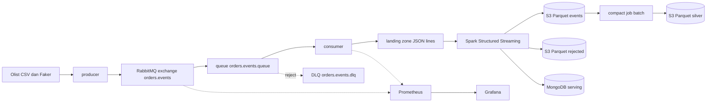

# Architecture

Pipeline streaming untuk event e-commerce. Dataset Olist diputar ulang sebagai stream event, melewati RabbitMQ dan landing zone, diproses Spark Structured Streaming, lalu masuk ke data lake (S3) dan serving layer (MongoDB).

## Alur data

## Komponen

| Komponen | Peran | Catatan |
|----------|-------|---------|
| producer | Muat CSV Olist, tambah event stok dan event rusak dari Faker, urutkan menurut event_time, lalu replay | Mode time_compression atau fixed_rate, diatur lewat .env |
| RabbitMQ | Exchange topic orders.events, queue utama, dead letter exchange orders.dlx, dead letter queue | Topologi dimuat dari rabbitmq/definitions.json |
| consumer | Baca queue, tulis micro-batch JSON lines ke landing zone, nack pesan rusak ke DLQ, expose metrik | Jembatan ke Spark karena Structured Streaming tidak punya source bawaan RabbitMQ |
| Spark | File stream dari landing zone, validasi, dedup, agregasi Spark SQL, tulis ke Parquet dan MongoDB | Parquet ke S3 lewat s3a, MongoDB lewat foreachBatch dan pymongo |
| S3 | Data lake Parquet: lake/events (bronze), lake/rejected, dan lake/silver/events | Bucket terenkripsi, akses publik diblokir |
| compact | Job batch: baca lake/events, dedup penuh per event_id, tulis lake/silver/events | Dijalankan manual lewat docker compose run, di produksi dijadwalkan orkestrator |
| MongoDB | Serving: orders_current, stock_current, metrics_window, dan ledger processed_events | Single node replica set supaya transaksi tersedia |
| Prometheus dan Grafana | Throughput queue, lag consumer, latency publish_time ke landing | Dashboard disediakan sebagai kode di monitoring/grafana |

## Semantik waktu

event_time adalah timestamp asli Olist (tersebar 2016 sampai 2018) dan disimpan untuk analisis historis. publish_time adalah waktu event dikirim producer. Window dan watermark Spark memakai publish_time, karena event_time tidak cocok untuk window streaming pada replay.

| Event | Sumber waktu | Offset |
|-------|--------------|--------|
| order_created | order_purchase_timestamp | +0 detik |
| order_item | order_purchase_timestamp | +1 detik, ditambah order_item_id dalam milidetik |
| payment | order_purchase_timestamp | +2 detik, ditambah payment_sequential dalam milidetik |
| order_status_changed | order_approved_at, order_delivered_carrier_date, order_delivered_customer_date | Tanpa offset, kolom null dilewati |
| stock_updated | Acak dalam rentang waktu event Olist | Dibuat Faker dengan seed tetap |

## Validasi dua lapis

| Lapis | Yang diperiksa | Hasil bila gagal |
|-------|----------------|------------------|
| consumer | Envelope: JSON valid, event_type dikenal, event_id dan event_time terisi | nack tanpa requeue, pesan masuk DLQ |
| Spark | Payload: field wajib per tipe, timestamp bisa diparse, nilai uang tidak negatif | Event masuk lake/rejected dengan kolom error_reason |

## Idempotency dan semantik pengiriman

| Titik | Mekanisme | Efek |
|-------|-----------|------|
| producer | event_id deterministik (uuid5 dari tipe dan identitas event) | Event yang sama selalu punya id yang sama |
| consumer | Manual ack setelah file landing ditulis, file ditulis ke temp lalu rename atomik | At-least-once, Spark tidak pernah membaca file setengah jadi |
| Spark | dropDuplicatesWithinWatermark pada event_id, watermark 30 menit atas publish_time | Duplikat dalam jendela 30 menit dibuang |
| orders_current dan stock_current | Upsert dengan aturan latest wins berdasarkan event_time | Event telat tidak menimpa status yang lebih baru, hasil sama walau ditulis berulang |
| metrics_window | Ledger processed_events, insert ledger dan $inc dalam satu transaksi MongoDB | Retry atau replay batch tidak menghitung dua kali |
| Spark checkpoint | Checkpoint per query dan metadata file sink | Restart melanjutkan dari batch terakhir |
| compact | Satu baris per event_id (publish_ts paling awal), verifikasi jumlah sebelum menulis, overwrite partisi dinamis | Dijalankan berulang kali hasilnya sama |

Kesimpulannya: efek di serving layer idempotent. Dokumen ini tidak mengklaim exactly-once end to end.

## Hasil verifikasi

| Uji | Hasil |
|-----|-------|
| Kirim 3000 event, consumer menulis landing | 2984 event masuk landing, 16 masuk DLQ, total 3000 |
| Landing berisi dua run producer (5968 baris), diproses Spark | 2878 event valid unik di lake/events, 118 baris di lake/rejected (92 missing_field, 26 negative_value) |
| Replay penuh dari checkpoint kosong, dua kali | Ledger, metrics_window, orders_current, dan stock_current tetap 2878, 2878, 480, 253. Log Spark mencatat 2878 event dilewati ledger. |
| Parquet di S3 dibaca ulang lewat Spark | 2878 event, 2878 event_id unik |
| Consumer dimatikan 40 detik saat producer 50 event per detik | Antrean menumpuk lalu habis setelah consumer hidup, queue utama kembali 0, tidak ada kehilangan yang teramati |
| Latency publish_time ke landing | p50 sekitar 2.5 detik, p95 sekitar 4.8 detik, didominasi BATCH_FLUSH_SECONDS=5 |
| Shutdown consumer | 0.4 detik setelah command berbentuk list sehingga Python menjadi PID 1 (sebelumnya 10.4 detik karena SIGTERM tidak sampai ke Python) |
| Bronze berisi event yang diputar ulang setelah lewat watermark | Bronze 8630 baris dengan 5752 event_id unik (2878 duplikat). Compact menghasilkan silver 5752 baris, satu per event_id. |
| Compact dijalankan dua kali | Jumlah objek silver tetap 22 dan ukurannya tetap 802431 byte, semua hitungan sama |
| Load test 560000 event dalam lima tahap | 555705 masuk landing ditambah 4295 masuk DLQ sama dengan 560000. Ledger dan lake sama-sama 536341 event unik. Detail di docs/load-test.md |

## Keterbatasan yang diketahui

| Keterbatasan | Dampak | Rencana |
|--------------|--------|---------|
| Dedup streaming dibatasi watermark 30 menit | Event yang sama setelah jendela itu bisa masuk lake/events lagi. Serving layer tetap benar karena ledger dan upsert. | Ditutup oleh job compact (layer silver), lihat hasil verifikasi. Bronze tetap berisi duplikat karena berfungsi sebagai catatan mentah. |
| Ledger processed_events kedaluwarsa 30 hari | Event yang dikirim ulang setelah 30 hari bisa dihitung lagi di metrics_window | Batas desain, retensi ditentukan kebutuhan bisnis |
| Penulisan silver ke S3 lambat (84 detik untuk 5752 baris, 170 detik untuk 57435 baris) | Biaya dominan per file dan per batch di S3, bukan per baris | Pertimbangkan S3A committer |
| Latency diukur sampai landing zone | 99 persen di bawah 2 detik pada beban sekitar 290 per detik, belum termasuk trigger Spark dan waktu tulis sink | Estimasi ujung ke ujung 25 sampai 30 detik dihitung dari durasi batch, belum diukur langsung |
| Spark tidak mengekspos metrik Prometheus | Progres streaming dilihat lewat Spark UI di port 4040 | Tambah metrik progres query |
| foreachBatch mengumpulkan baris ke driver | Tidak scale untuk volume besar | Produksi memakai sink terdistribusi |
| Semua service berjalan di satu mesin | Tidak ada high availability | Lihat pemetaan produksi |
| Credential lokal lewat .env | Cocok untuk lokal saja | Secrets manager di produksi |
| Container Spark berjalan sebagai root | Demi izin tulis ke bind mount | User non-root dan permission volume yang tepat |

## Pemetaan ke produksi

| Lokal | Produksi |
|-------|----------|
| RabbitMQ, consumer, landing zone | Kafka, dibaca langsung oleh Spark |
| Docker Compose | Kubernetes atau layanan terkelola |
| compact dijalankan manual | Dijadwalkan orkestrator seperti Airflow |
| Spark local[2] | Spark terkelola (misalnya EMR atau Databricks) |
| MongoDB single node replica set | Replica set multi node atau layanan terkelola |
| Prometheus dan Grafana lokal | Monitoring terkelola dengan alerting |
| Credential di .env | Secrets manager dan peran IAM |

## Rencana lanjutan

CI untuk lint dan test. Hasil uji kegagalan ada di docs/failure-drills.md dan hasil load test ada di docs/load-test.md.
